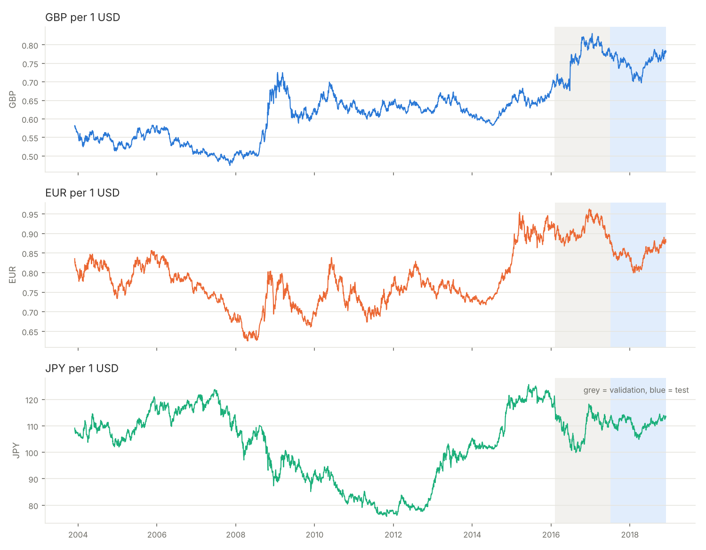
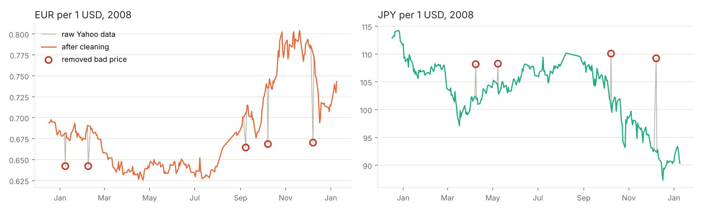
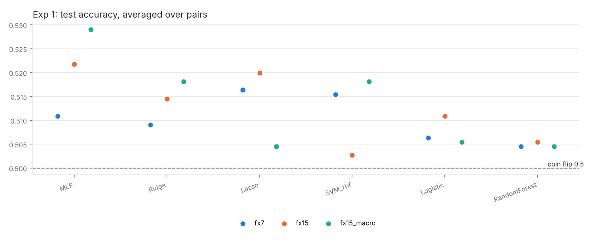
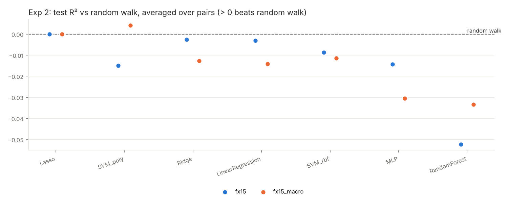
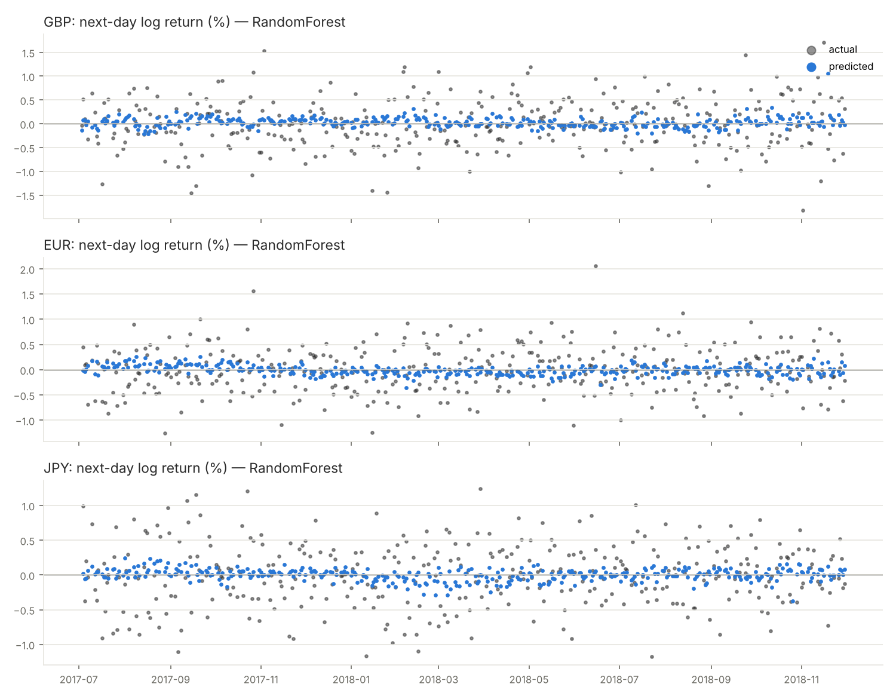
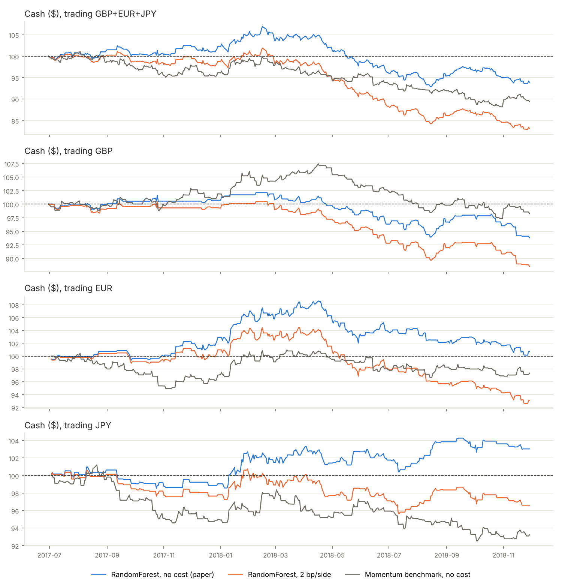
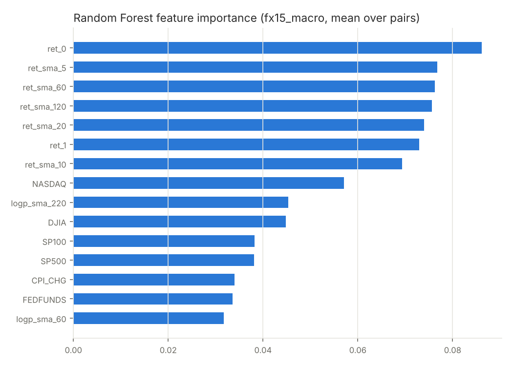

# Foreign Currency Exchange Rate Forecast: Replicating CS229 #34 on Public Data

**Course:** Machine Learning — Mini Project
**Team:** Catherine D (CS120) · Yashwitha (CS121)
**Date:** November 2026
**Code and data:** [https://github.com/yashwitha18/forex-forecast](https://github.com/yashwitha18/forex-forecast)

---

## Abstract

We replicate the Stanford CS229 project *Foreign Currency Exchange Rate Forecast* (Zhang, Sun &
Zhang, 2019). The study forecasts daily movements of GBP, EUR and JPY against the US dollar with
six machine-learning models, in two experiments: next-day direction (classification) and
next-day log return (regression), the second followed by a $100 trading simulation. We use the
paper's currency pairs, features, models, 80/10/10 split, metrics and trading rule. Bloomberg
and CRSP are replaced by free Yahoo Finance and FRED data covering December 2003 – November 2018.
We add explicit baselines, point-in-time alignment of economic data, removal of bad price
records, transaction costs and significance tests. No model shows reliable skill. Test-set
direction accuracy ranges from 0.503 to 0.529 against a coin flip of 0.5, and none is
significant after correcting for the number of models tried. Every regression model's test R²
is between −0.052 and +0.004 relative to a random walk. The model chosen on the validation set
is Lasso with every coefficient shrunk to zero, i.e. a constant forecast. The paper's Random
Forest results (test R² 0.70–0.78, up to $110.50 from $100) do not replicate: we obtain R²
between −0.06 and −0.02 and $83–$97 after costs. Our results agree with Meese & Rogoff (1983):
past prices and public macro data do not predict daily exchange-rate moves.

---

## 1. Introduction

Exchange rates set the price of every cross-border transaction, so firms, investors and
governments face currency risk. Forecasting them is notoriously hard. Meese and Rogoff (1983)
showed that a random walk ("tomorrow's rate equals today's") forecasts better than structural
economic models, and the result has largely held for four decades.

The CS229 project #34 asked whether modern machine learning changes that. It reported that a
Random Forest explains about 74% of the variance of daily log returns and earns up to 10.5% in a
simple trading simulation over 2017–2018.

**Our goal** is to reproduce that study as closely as possible on publicly available data, and
to test its claims against explicit baselines with realistic data timing. Our contributions:

1. A faithful, open re-implementation of both experiments and the profit simulation.
2. Fixes needed for a valid result: random-walk and majority baselines, economic data used only
   after its publication date, removal of isolated bad price records, and trading costs.
3. Significance testing, plus validation-period and random-seed checks for every result that
   looked better than chance.

## 2. Related Work

- **Zhang, Sun & Zhang (2019), CS229 #34.** Daily USD/GBP, USD/EUR and USD/JPY closes,
  2001–2018 (Bloomberg). They use 15 engineered exchange-rate features plus stock-index and US
  macro factors (CRSP), an 80/10/10 split, and Logistic, Lasso, Ridge, SVM, MLP and Random
  Forest models. Results: sign accuracy about 0.51–0.55 (their Table 1), Random Forest selected
  by validation R² of 0.74 (Table 2), test R² 0.70–0.78 (Table 4), and final cash
  $100.33–$110.50 (Table 3).
- **Meese & Rogoff (1983).** The random walk beats structural exchange-rate models out of sample.
- **Kuan & Liu (1995).** Neural networks for exchange rates; some show market-timing ability
  relative to the random walk.
- **Gu, Kelly & Xiu (2020).** Machine learning in empirical asset pricing. They use out-of-sample
  R² measured against a zero forecast, the convention we adopt (§7).
- **Campbell & Thompson (2008).** Out-of-sample R² relative to a naive benchmark as the standard
  test of return predictability.

## 3. Dataset

| | Paper | Ours | Reason |
|---|---|---|---|
| Exchange rates | Bloomberg, daily close | Yahoo Finance `GBP=X`, `EUR=X`, `JPY=X` (foreign currency per USD) | Bloomberg is paid |
| Period | Jan 2001 – Nov/Dec 2018 | **1 Dec 2003 – 30 Nov 2018** | Yahoo's GBP and EUR history starts Dec 2003 |
| Stock indexes | S&P 500, S&P 100, Nasdaq, DJIA (CRSP) | same, Yahoo `^GSPC ^OEX ^IXIC ^DJI` | CRSP is paid |
| Economic factors | CPI change, Fed funds, NBER recession indicator, federal debt (CRSP) | same series from FRED: `CPIAUCSL`, `DFF`, `USREC`, `GFDEBTN` | not available on Yahoo |

All raw files are committed under `data/raw/`. The end date matches the paper, so our test
period (30 Jun 2017 – 29 Nov 2018) almost coincides with theirs (3 Mar 2017 – 30 Nov 2018).

**Table 1 — Daily log returns after cleaning** (`results/summary_stats.csv`)

| Pair | Trading days | Rate range | Mean (%) | Std dev (%) | Skew | Excess kurtosis | Up days (%) |
|---|---|---|---|---|---|---|---|
| GBP | 3,899 | 0.474 – 0.831 | 0.008 | 0.602 | 0.82 | 9.98 | 49.9 |
| EUR | 3,882 | 0.625 – 0.962 | 0.001 | 0.626 | 0.01 | 2.28 | 49.5 |
| JPY | 3,883 | 75.74 – 125.63 | 0.001 | 0.646 | 0.02 | 3.92 | 50.4 |

The mean daily return is essentially zero, the typical day moves about 0.6%, and up and down
days are equally frequent. Before any model is trained, the data already suggest there is
little to predict. GBP's high kurtosis comes mostly from the Brexit referendum move
(+7.9% in one day).

*Figure 1. The three rates (foreign currency per USD); grey = validation, blue = test.*

## 4. Preprocessing

From `results/data_report.json`:

- **Missing / duplicate / non-positive closes:** none in any series.
- **Weekends and holidays are not filled.** "Next day" means the next available trading day.
  Forward-filling would create fake 0% return days.
- **Calendar gaps:** EUR and JPY have no Yahoo rows for most of August 2008 (gaps ending
  8 Aug and 26 Aug 2008); GBP has one gap ending 23 Jan 2008. These are left as gaps.
- **Point-in-time economic data.** Each value is attached to a trading day only from the date
  it would have been public: CPI and recession flag +45 days, federal debt +180 days, Fed funds
  +1 day, stock-index returns +1 trading day. Without this, March CPI (released mid-April) would
  be "known" on 1 March, which is look-ahead bias. A unit test enforces this.

**Bad price records removed.** Yahoo's EUR and JPY history contains isolated wrong prices in
2008. Each is a 3–15% one-day spike on the 8th of a month that fully reverses the next day.
Example: EUR on 5 Sep 2008 = 0.7005, on 8 Sep = 0.6645, on 9 Sep = 0.7068. GBP shows nothing
on the same dates.

**Rule.** Drop a row if its log price is more than 3% from the midpoint of its two neighbours,
on the same side of both, while the neighbours agree with each other (a spike that snaps
back). This removes **5 EUR rows** (8 Jan, 8 Feb, 8 Sep, 8 Oct, 8 Dec 2008) and **4 JPY rows**
(8 Apr, 8 May, 8 Oct, 8 Dec 2008), and nothing in GBP. Genuine moves such as Brexit are level
shifts that do not snap back, so they are kept. The rule is applied to FX only; for stock
indexes a 3% spike-and-revert is usually a real crisis day.

**Effect.** EUR excess kurtosis falls from 89.5 to 2.3, and JPY's from 110.9 to 3.9 (Figure 0).
§9.4 shows our conclusions do not depend on this step.

*Figure 0. EUR and JPY in 2008: raw Yahoo data (grey), the cleaned series, and the removed bad prices (red circles).*

## 5. Features

As in the paper (§3.2), built per pair for each trading day *t* using data up to *t* only:

| Set | Features | Count |
|---|---|---|
| `fx7` (paper's initial set) | log return today, log return yesterday, mean log return over the last 5, 10, 20, 60, 120 days | 7 |
| `fx15` (paper's final set) | `fx7` + log rate, its square, its cube, mean log rate over the last 5, 10, 20, 60, 220 days | 15 |
| `fx15_macro` (paper's full set) | `fx15` + daily log returns of S&P 500, S&P 100, Nasdaq, DJIA + CPI % change, Fed funds rate, NBER recession flag, federal debt % change | 23 |

**Targets:** Exp 1: `up` = 1 if tomorrow's log return > 0. Exp 2: tomorrow's log return
r = log(ratet+1 / ratet).

**Leakage checks** (`tests/test_pipeline.py`, 9 tests, all pass): changing every price after day
*k* leaves all features up to *k* unchanged; macro values never appear before their
publication lag; the split is strictly chronological.

The first usable row is 1 Oct 2004, because the 220-day average needs about a year of history.

## 6. Methods

**Split (paper §3.1).** Chronological 80 / 10 / 10 per pair:

| Pair | Train | Validation | Test |
|---|---|---|---|
| GBP | 2,943 days (Oct 2004 – 1 Feb 2016) | 368 (Feb 2016 – Jun 2017) | 368 (30 Jun 2017 – 29 Nov 2018) |
| EUR | 2,929 (Oct 2004 – 4 Feb 2016) | 366 | 367 (3 Jul 2017 – 29 Nov 2018) |
| JPY | 2,930 (Oct 2004 – 4 Feb 2016) | 366 | 367 (3 Jul 2017 – 29 Nov 2018) |

Hyperparameters are chosen on validation; the chosen model is refit on train + validation and
scored once on test.

**Models (paper §4).** All except Random Forest use standardised features.

| Exp 1 (classification) | Exp 2 (regression) | Hyperparameters searched |
|---|---|---|
| Logistic regression | Linear regression (added, from our proposal) | — |
| Lasso = L1 logistic | Lasso | C ∈ {0.01, 0.1, 1} / α ∈ {0.001, 0.01, 0.1} |
| Ridge classifier | Ridge | α ∈ {0.1, 1, 10, 100} |
| SVM, RBF kernel | SVR, RBF and polynomial (degree 3) kernels | C ∈ {0.1, 1, 10} / {0.1, 1} |
| Random Forest, 1000 trees, max depth 100 (as in the paper) | same | — |
| MLP (64, 32), early stopping | same | α ∈ {10⁻⁴, 10⁻²} |

In Exp 2 the target is standardised too. Daily returns are around 0.005, far below SVR's default
ε = 0.1, so without this SVR would treat every error as zero.

**Baselines (added).** Exp 1: *majority class* and *same direction as today*. Exp 2: *random
walk* (predict 0 return, i.e. tomorrow's rate = today's), *historical mean* return, and
*momentum* (tomorrow's return = today's).

## 7. Experiments and Metrics

**Exp 1, sign prediction:** the paper's metrics, with up = +1 and down = −1.
Acc = share correct; NMSE = mean((s − ŝ)²) / var(s); MAE = mean|s − ŝ| = 2(1 − Acc);
DS = share with matching direction (= Acc for a classifier); CU = share of actual up days
predicted up; CD = share of actual down days predicted down.

**Exp 2, log-return regression:**
- R², the paper's metric, used on validation to choose the model as the paper did.
- R² vs random walk = 1 − SSE(model) / SSE(predict 0). Above 0 means the model beats
  "tomorrow = today" (Campbell & Thompson, 2008; Gu, Kelly & Xiu, 2020).
- MAE and RMSE in basis points (1 bp = 0.01%), and directional accuracy.

**Profit simulation (paper §5.2).** Start with $100. Each day, take the predicted ratio
R̂ = er̂ for each currency. If all R̂ ≥ 1, stay in USD. Otherwise hold the
currency with the lowest R̂ for one day; cash is multiplied by 1 / (actual ratio). This is run
for all 7 currency combinations at **0 cost (paper)** and **2 bp per conversion (added)**. A test
reproduces the paper's worked example ($100 / 0.95 = $105.26).

**Significance (added).** For each model, test days are pooled across the three pairs, and a
one-sided binomial test asks whether directional accuracy beats 0.5. Bonferroni correction is
applied for the number of models tried (18 in Exp 1, 14 in Exp 2).

## 8. Results

### 8.1 Experiment 1 — sign prediction (paper Table 1)

**Table 2 — Test set, paper's full feature set (`fx15_macro`), averaged over the 3 pairs.**
Paper values in brackets.

| Model | Acc | NMSE | MAE | DS | CU | CD |
|---|---|---|---|---|---|---|
| Logistic | 0.505 (0.51) | 1.980 (1.97) | 0.989 (0.98) | 0.505 (0.51) | 0.570 (0.45) | 0.439 (0.57) |
| Lasso | 0.505 (0.52) | 1.983 (1.90) | 0.991 (0.95) | 0.505 (0.52) | 0.526 (0.47) | 0.481 (0.58) |
| Ridge | 0.518 (0.55) | 1.929 (1.81) | 0.964 (0.91) | 0.518 (0.55) | 0.509 (0.58) | 0.523 (0.51) |
| SVM (RBF) | 0.518 (0.51) | 1.929 (1.95) | 0.964 (0.97) | 0.518 (0.51) | 0.462 (0.57) | 0.570 (0.52) |
| Random Forest | 0.505 (0.53) | 1.983 (2.03) | 0.991 (1.02) | 0.505 (0.49) | 0.623 (0.44) | 0.393 (0.49) |
| MLP | 0.529 (0.52) | 1.885 (1.92) | 0.942 (0.96) | 0.529 (0.52) | 0.540 (0.54) | 0.514 (0.52) |
| *Majority class* | 0.496 | 2.016 | 1.007 | 0.496 | 0.667 | 0.333 |
| *Same as today* | 0.476 | 2.096 | 1.047 | 0.476 | 0.465 | 0.487 |

All 18 model × feature-set combinations score between **0.503 and 0.529**
(`results/exp1_sign_avg.csv`, Figure 2). This **agrees with the paper**, whose models scored
0.51–0.55. Our encoding also reproduces the paper's internal arithmetic: their Lasso has
Acc 0.52 and MAE 0.95, and 2 × (1 − 0.52) = 0.96.

**Is anything better than chance?** (`results/significance_exp1.csv`)
- The best test accuracy, MLP on `fx15_macro` (0.529, 583/1102 days), has one-sided p = 0.029,
  but **p = 0.52 after Bonferroni** correction for 18 models.
- The models validation would have chosen score 0.518 (SVM, `fx15_macro`), 0.511 (MLP, `fx7`)
  and 0.505 (RF, `fx15`). None is significant: p = 0.12, 0.24 and 0.37.

*Figure 2. Exp 1 test accuracy for every model and feature set; dashed line = coin flip.*

### 8.2 Experiment 2 — log-return regression (paper Tables 2 and 4)

**Table 3 — Validation R² used for model selection (paper Table 2), `fx15_macro`, mean over pairs**

| | Random Forest | MLP | SVM RBF | SVM poly | Lasso | Ridge | Linear reg. |
|---|---|---|---|---|---|---|---|
| **Paper** | **0.74** | −∞ | 0 | −0.02 | 0.01 | 0.01 | — |
| **Ours** | −0.667 | −0.044 | −0.007 | −0.181 | **−0.0005** | −0.028 | −0.806 |

The paper selected Random Forest. With the same procedure we select **Lasso**: validation picks
α = 0.1, which shrinks every coefficient to zero. The "best" model therefore ignores all 23
features and predicts the constant training-set mean return every day.

**Table 4 — Test set, mean over pairs** (`results/exp2_return_avg.csv`)

| Model | Features | R² vs random walk | MAE (bp) | RMSE (bp) | Direction acc. |
|---|---|---|---|---|---|
| *Random walk* | — | 0 (by definition) | 36.38 | 46.66 | — |
| *Historical mean* | — | −0.00001 | 36.39 | 46.66 | 0.489 |
| *Momentum* | — | −1.112 | 54.48 | 67.76 | 0.477 |
| Lasso (selected) | fx15 / fx15_macro | −0.00001 | 36.39 | 46.66 | 0.489 |
| Linear regression | fx15_macro | −0.014 | 36.70 | 47.01 | 0.503 |
| Ridge | fx15_macro | −0.013 | 36.58 | 46.98 | 0.504 |
| SVM RBF | fx15_macro | −0.011 | 36.54 | 46.94 | 0.513 |
| SVM poly | fx15_macro | +0.004 | 36.27 | 46.57 | 0.554 |
| Random Forest | fx15_macro | −0.034 | 37.17 | 47.46 | 0.489 |
| Random Forest | fx15 | −0.052 | 37.50 | 47.88 | 0.487 |
| MLP | fx15_macro | −0.031 | 36.79 | 47.40 | 0.535 |

**Table 5 — Random Forest test R² by pair (paper Table 4)**

| | GBP | EUR | JPY |
|---|---|---|---|
| Paper | 0.70 | 0.78 | 0.74 |
| Ours (`fx15_macro`) | −0.062 | −0.021 | −0.018 |

Only one model is above zero: SVM poly at +0.004, i.e. 0.4% lower squared error than the random
walk. Random Forest is the worst learned model, 3.4–5.2% worse than doing nothing.

*Figure 3. Test R² relative to the random walk; above the dashed line = better than "tomorrow = today".*

*Figure 4. Random Forest predicted vs actual next-day log returns (paper Figure 2). Predictions
cluster near zero while actual returns spread ±1.5%.*

**Two results that looked like skill, and why they are not**

1. **SVM poly direction accuracy 0.554** (p = 0.0002; Bonferroni p = 0.002). Validation chose
   neither this model nor its hyperparameters (validation R² −0.18). Trained on the training
   set only, its directional accuracy on the *validation* period is 0.489 (GBP), 0.481 (EUR)
   and 0.514 (JPY), i.e. no skill. A real signal should appear in both periods; this one
   appears only in the 17-month test window (`results/diagnose_SVM_poly_fx15_macro.csv`).
2. **MLP direction accuracy 0.535** (p = 0.010; Bonferroni p = 0.14). Re-training with five other
   random seeds gives 0.474, 0.516, 0.492, 0.502 and 0.499. The default seed (42) happened to be
   the luckiest (`results/seeds_MLP_fx15_macro.csv`).

### 8.3 Profit simulation (paper Table 3, Figure 3)

**Table 6 — Final cash from $100, Random Forest, test period** (`results/backtest_summary.csv`)

| Currencies traded | Paper | Ours, no cost | Ours, 2 bp/side | Momentum, no cost | Days held foreign |
|---|---|---|---|---|---|
| GBP | 104.40 | 93.81 | 88.52 | 98.26 | 39% |
| JPY | 104.44 | 103.03 | 96.61 | 93.22 | 44% |
| EUR | 110.50 | 100.75 | 93.12 | 97.34 | 54% |
| GBP + JPY | 100.33 | 95.82 | 86.73 | 89.19 | 68% |
| JPY + EUR | 109.46 | 97.56 | 87.78 | 89.00 | 72% |
| GBP + EUR | 104.88 | 97.09 | 87.57 | 95.07 | 70% |
| GBP + JPY + EUR | 101.30 | 93.94 | 83.15 | 89.42 | 83% |

- Without costs, the Random Forest loses money in 5 of 7 cases. With all three currencies it
  peaks at $106.91 (Feb 2018), then falls to $93.94 (max drawdown −13.1%).
- With a 2 bp cost per conversion, **all 7 cases lose money ($83–$97)**. Trading on 39–83% of
  days makes costs dominate.
- The selected model (Lasso) predicts a small positive return every day, so R̂ > 1 for every
  currency and it never trades: **$100.00 in all cases**.

*Figure 5. Cash over the test period: Random Forest without cost (paper setting), with 2 bp per side, and the momentum benchmark.*

### 8.4 What the Random Forest relied on

*Figure 6. Mean impurity importance over the three pairs (`fx15_macro`).*

The top features are the recent-return features (today's return and its 5–120 day averages),
then Nasdaq and other index returns. CPI, Fed funds and debt rank low. High importance does not
mean useful prediction: a deep forest splits on whatever varies most, including noise. That is
consistent with its negative test R².

## 9. Discussion

**9.1 Direction prediction is a coin flip, in our data and in the paper's.** Our Table 2 sits in
the same 0.50–0.53 band as the paper's Table 1, and no model beats chance once multiple
comparisons are accounted for. The paper's interpretation agrees ("accuracy values are all
around 50%").

**9.2 The paper's regression results do not replicate.** Their Random Forest R² of 0.70–0.78 on
daily log returns is incompatible with their own ~0.5 sign accuracy. A model explaining three
quarters of the variance of returns would get the direction right most of the time. On public
data, the same model, features and protocol give test R² of −0.06 to −0.02. The paper gives the R²
formula but not exactly which predictions it was computed on. Likely explanations are R² computed on in-sample or
overlapping data, or features that include information from day t+1.

**9.3 The random walk wins.** The validation set chooses a Lasso so heavily regularised that it
predicts a constant. In effect, the data are telling us that the best forecast of tomorrow's
return is (almost) zero. That is Meese & Rogoff's finding, now from a machine-learning
pipeline. Momentum (assuming today's move repeats) is much worse than the random walk
(R² vs RW = −1.11), which confirms daily moves have no simple persistence.

**9.4 Robustness to data cleaning.** We also ran the full pipeline on the raw data, before
removing the 9 bad prices.
- **Unchanged:** Lasso is still selected. Every Exp 1 accuracy stays in 0.49–0.53. Random Forest
  R² vs RW on `fx15_macro` is still negative (−0.060 raw vs −0.034 cleaned).
- **Changed:** Random Forest's no-cost profit on EUR moves from $104.32 to $100.75, showing how
  fragile the backtest numbers are.

**9.5 Did the economic factors help?** Not reliably. Adding them raised some Exp 1 accuracies
(MLP 0.522 → 0.529, SVM 0.503 → 0.518) and lowered others (Lasso 0.520 → 0.505). In Exp 2 they
made most regressors slightly worse (e.g. MLP −0.014 → −0.031). With monthly or quarterly
updates and publication lags, they carry almost no information about tomorrow.

**9.6 Why the backtest misleads.** A single ~17-month path with no costs can show gains by
luck. During development, models run on synthetic random-walk data, which is unpredictable by
construction, still ended at $110–$120 at zero cost. The paper's $110.50 is within that range.
Costs, a benchmark and a significance test are needed before reading anything into final cash.

## 10. Limitations and Future Work

- **Single split.** One 17-month test window. Walk-forward evaluation over many windows would
  give a distribution of results instead of one number.
- **Significance testing.** Our binomial tests assume independent days and cover direction
  only. A Diebold–Mariano test on forecast errors versus the random walk is the standard
  stronger check.
- **Data.** Yahoo instead of Bloomberg (shorter history, bad prices that needed cleaning,
  August 2008 missing for EUR/JPY). The NBER recession flag is declared months after the fact,
  so even lagged it contains hindsight.
- **Costs.** A flat 2 bp per side, with no bid–ask modelling and no interest earned on the
  currency held.
- **Future work:** walk-forward validation; Diebold–Mariano tests; LSTM/GRU models (the paper's
  own suggestion); higher-frequency data or interest-rate differentials, which economic theory
  links to currency moves.

## 11. Conclusion

We rebuilt CS229 #34 end to end on public data and kept everything the paper specified. The
sign-prediction results replicate: about 50%, no better than a coin flip. The headline
regression and trading results do not. Random Forest's test R² is negative rather than
0.70–0.78, the validation set prefers a constant forecast, and every trading combination loses
money once a 2 bp cost is included. The two results that briefly looked like skill disappeared
on the validation period and under different random seeds. Our main lesson is methodological:
**without a random-walk baseline, point-in-time data and validation checks, daily FX
forecasting results are easily overstated.** With them, the 1983 conclusion still stands.

## References

1. J. Zhang, J. Sun, J. Zhang. *Foreign Currency Exchange Rate Forecast.* CS229 project report and poster, Stanford University, 2019. https://cs229.stanford.edu/proj2019spr/report/34.pdf
2. R. Meese, K. Rogoff. Empirical exchange rate models of the seventies: Do they fit out of sample? *Journal of International Economics* 14, 1983.
3. J. Y. Campbell, S. B. Thompson. Predicting excess stock returns out of sample: Can anything beat the historical average? *Review of Financial Studies* 21(4), 2008.
4. S. Gu, B. Kelly, D. Xiu. Empirical asset pricing via machine learning. *Review of Financial Studies* 33(5), 2020.
5. C.-M. Kuan, T. Liu. Forecasting exchange rates using feedforward and recurrent neural networks. *Journal of Applied Econometrics* 10(4), 1995.
6. F. X. Diebold, R. S. Mariano. Comparing predictive accuracy. *Journal of Business & Economic Statistics* 13(3), 1995.
7. F. Pedregosa et al. Scikit-learn: Machine learning in Python. *JMLR* 12, 2011.
8. Yahoo Finance historical data (GBP=X, EUR=X, JPY=X, ^GSPC, ^OEX, ^IXIC, ^DJI); Federal Reserve Bank of St. Louis, FRED (CPIAUCSL, DFF, USREC, GFDEBTN). Retrieved November 2026.

## Appendix

**A. Reproduce.** Clone [https://github.com/yashwitha18/forex-forecast](https://github.com/yashwitha18/forex-forecast), then `pip install -r requirements.txt`, then `python main.py` (~10 min on a laptop),
`python -m src.diagnose`, and `python -m src.diagnose MLP fx15_macro --seeds`.

**B. Full result tables.** `results/exp1_sign_by_pair.csv`, `results/exp2_return_by_pair.csv`,
`results/backtest_summary.csv`, `results/significance_exp1.csv`,
`results/significance_exp2_direction.csv`.

**C. Contributions.**
Catherine D (CS120): data collection (Yahoo, FRED), cleaning and bad-print analysis,
feature engineering and point-in-time alignment, exploratory analysis, report §1–5.
Yashwitha (CS121): models and validation-based selection, metrics, profit simulation,
significance and robustness checks, report §6–9.
Both: research design, discussion, conclusion, presentation.
